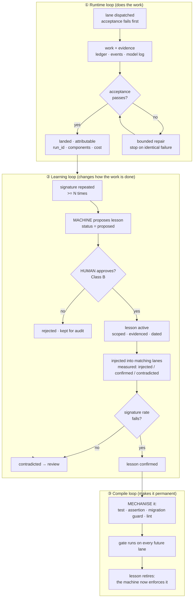

# HARPP Cognitive Architecture — refined (2026-11-17)

Supersedes the phase-1 design in `docs/ai/harpp-experience-repository.md` as the **target**
architecture. That document remains the record of what was deliberately deferred and why.

Origin: the ChatGPT thread (`.ai/consult/harpp-experience-repo-2026-11-17.chatgpt.md`) plus one day
of real use, which changed the design more than the research did.

---

## 1. What the day of use proved

The original concept was a **repository**: store experience, index it, retrieve it. Building and
then using it produced three findings that reshape the architecture:

1. **A repository is not a learner.** Six "lessons" exist and every one was written by a human. The
   tool is a notebook, not a learning system.
2. **A contract test is a compile check.** A lane scored 12/12 on a source-grepping acceptance while
   the feature failed five ways in a real browser: wrong role, impossible reversal, double count, an
   unappliable migration, an ENUM rejection. Verdicts are only as good as the criterion.
3. **A metric that lies is worse than no metric.** `wasted_cost_share` reported 87% on a day that
   produced two working features.

So the refinement is not more storage. It is **fewer, governed, falsifiable objects, and a path from
each one to something that runs.**

---

## 2. The architecture: Experience → Lesson → Gate



**The point of the third loop.** ChatGPT's target called it "experience → skill compilation": turn a
validated method into something executable so it stops costing a model call. For a software
repository the honest form of that is **not a CPU model — it is a test, an assertion, a migration
guard, or a lint rule.** A lesson that has been confirmed and mechanised stops being prose in a
prompt and becomes a gate that cannot be argued with. That is the only "skill compilation" this
codebase needs, and it needs no GPU.

A lesson therefore has exactly three useful states, and one terminal one:

```
proposed → active → confirmed → compiled(gate) → retired
              ↘ contradicted → review → rejected
```

---

## 3. The four objects

| Object | File | Question it answers | Governance |
|---|---|---|---|
| **Experience** | `.ai/autonomy/ledger.jsonl`, `.ai/runs/*` | what happened, with what evidence | machine-written, append-only |
| **Lesson** | `.ai/harpp/lessons.json` (today: `hints.json`) | what we learned, and how sure we are | **Class B** — machine proposes, human approves |
| **Gate** | `tests/`, `tools/acceptance-*.sh` | what the machine now enforces | **Class C** — never auto-created |
| **Trial** | `.ai/harpp/trials.jsonl` | did a *harness* change help, measured | Class B, unused so far |

### Lesson record (the refinement)

```json
{
  "id": "L-0007",
  "scope": {"kind": "module", "value": "daily-ledger"},
  "statement": "Ledger effect rows are append-only; never DELETE a reversed effect.",
  "origin": {"signature": "crash|", "evidence": ["dl-substitute-dispatch-item"]},
  "status": "proposed",
  "proposed_by": "signature-repeats",
  "approved_by": null,
  "introduced_at": "2026-11-17",
  "review_after": "2026-12-17",
  "injected": 0, "confirmed": 0, "contradicted": 0,
  "compiled_as": null
}
```

Four fields are load-bearing and none exist today:

- **`scope`** — a lesson about daily-ledger must not be pasted into a CMS task. Today every hint
  goes to every lane; at six that is harmless, at thirty it is noise that dilutes the rules.
- **`status`** — `proposed` is stored but **never injected**. Only `active` reaches a prompt. This is
  the gate that keeps model-generated text out of prompts until a human owns the wording.
- **`review_after`** — a lesson nobody confirms expires, so stale advice cannot accumulate.
- **`compiled_as`** — the path from lesson to gate. A lesson with no route to mechanisation is
  probably an opinion, not a lesson.

---

## 4. Retrieval: the only automatic path

```
lane-autonomy builds a prompt
    → scope = module(s) in --touches, or "harness"
    → harpp-experience lessons --scope <s> --status active --rank evidence --max-chars N
    → block placed BEFORE ## RULES (rules keep the last word)
```

Rules, each one earned today:

| Rule | Why |
|---|---|
| only `active` lessons inject | `proposed` is machine text; a human must own what a lane is told |
| scope must match the task | a CMS lane must not be told about ledger effects |
| rank by evidence count, cap by chars | the block was 1687/1800 chars after six lessons — silent truncation is a correctness bug, not a cosmetic one |
| counts yes, quotations no | a prior run's log text is model output; feeding it back is prompt injection |
| rules after lessons | the last thing read should be the authority, not history |

---

## 5. Philosophy → mechanism (the part that makes it more than branding)

| Principle | Executable mechanism, today |
|---|---|
| Understand the whole before decomposing | `signatures` + `report` are read before choosing a task |
| Question assumptions | the acceptance criterion must **fail** before dispatch; a criterion that already passes cannot discriminate |
| Learn from experience | lesson loop above, with `injected/confirmed/contradicted` |
| Preserve identity | Class C files: acceptance criteria, authority rules, this document, the lesson-approval path |
| Think independently | chair/Sol consulted on forks, not on every patch |
| Nothing claimed without evidence | verdicts come from outcomes: a browser 200, a DB row, a failing-then-passing gate |

---

## 6. Governance (Class A / B / C, mapped to this repo)

| Class | What | Who may change it |
|---|---|---|
| **A — automatic** | which active lessons inject, ranking weights, block size | `harpp-experience` itself |
| **B — human approval** | lesson statements, new gates, lane scripts, migrations | existing `/review` + release gate |
| **C — protected** | acceptance criteria, role/authority rules, the release gate policy, this architecture, the approval step in the lesson loop | owner only |

The one thing that must never become automatic is **deciding which lessons are true** — that is the
difference between a system that learns and one that drifts.

---

## 7. Efficiency: what this refuses to build

| Not built | Trigger to build it |
|---|---|
| **PostgreSQL** | a **second writer** (another machine or agent host) or a **second project** writing the same store. Postgres is not installed here, and a second daemon adds an outage mode: HARPP could not run when its database is down. |
| **MySQL** as the store | when the store must be shared across machines but a new daemon is still unwanted — MySQL is already running and already backed up on this box |
| embeddings / semantic retrieval | lessons > 30 **and** scoped keyword retrieval measurably picks the wrong ones |
| shared cross-project layer | a **second** project onboards |
| Evolution Laboratory (candidate harnesses scored offline) | ≥ 2 competing candidates for the same component |
| local ML / GPU anything | never for this repo — the CPU-side payoff is gates, not inference |

### Storage decision (measured 2026-11-17)

The owner's instruction was *"db type is immaterial — the importance is efficiency; if PostgreSQL
is better suited, use it."* Settled by measurement:

| Measurement | Result |
|---|---|
| SQLite / FTS5 present | **3.45.1 with FTS5** |
| `psql` / `postgres` present | **not installed** |
| real store: 293 rows | rebuild **442 ms**, query **0.05 ms**, **116 KB** |
| projected 100,000 rows | query **0.07 ms**, **44 MB** |
| network round trip to a server DB | ~0.5–2 ms per query — **slower than the query itself** |

So: **PostgreSQL is not better suited here**, and adopting it would make the system less efficient
— a daemon to install, secure and back up, encoding a new failure mode where HARPP cannot record
experience because its database is down, to serve 293 rows in 0.07 ms.

- **JSONL remains the truth** — append-only, crash-safe, diffable.
- **SQLite + FTS5 is the derived index** — `.ai/harpp/experience.db`, deletable and rebuildable from
  the sources at any time, so it can never become a second source of divergent truth.
- **The swap point is two functions** (`cmd_index` / `cmd_search`). Callers never write SQL, so
  moving to PostgreSQL or MySQL changes no interface and no record.

**The defect was retrieval, not storage.** The first index had neither stemming nor ranking, so a
lesson containing `reversed` stayed invisible to the query `reversing`, and results arrived in
insertion order rather than by relevance. Fixed with `tokenize='porter unicode61'` and
`ORDER BY bm25(...)`, pinned by a regression test. Storing experience is not the objective; handing
it back when it is relevant is.

**Reversal triggers** — any one reopens this: a second writer or a second project on the same store;
a rebuild still over 2 s; > 5000 rows with keyword retrieval measurably returning the wrong lessons.
Full record: `docs/agent/DECISIONS.md` D-2026-11-17d.

### Lesson storage — superseded 2026-11-17

The lesson store described above as `.ai/harpp/hints.json` is **gitignored**, so it died on a fresh
clone. Lessons now live in `harpp-memory/` as one immutable event file each, tracked in git and
replayed into state. See **`docs/ai/harpp-memory.md`** (D-2026-11-17e). Injection is bounded to the
six highest-activation lessons, so a large store cannot bloat a prompt.

Cost discipline is already live: `cost_usd`, `tokens`, `run_id` and component hashes exist on new
rows, and waste is measured as *paid for nothing retained* (rolled back, or zero changed files) —
which is the only definition that did not lie.

---

## 8. Delivery plan, each step with an outcome-based criterion

| Phase | Deliverable | Acceptance (must fail before, pass after) |
|---|---|---|
| **P1** | lesson schema + `status` gating + scoped retrieval + `harpp-experience status` | a `proposed` lesson appears in **no** rendered prompt; an `active` daily-ledger lesson appears only when `--touches modules/daily-ledger` |
| **P2** | `signatures --propose` drafts a lesson for any signature repeated ≥ N times, `status: proposed` | a repeated signature yields one draft; the draft is absent from the next prompt until approved |
| **P3** | effectiveness: `injected/confirmed/contradicted`, `review_after` expiry | a lesson whose signature rate does not fall is marked `contradicted` and flagged in `status` |
| **P4** | `lesson compile <id>` emits a gate skeleton (test/assertion) and routes it through the normal acceptance | a compiled lesson's gate fails when the defect is reintroduced |
| **P5** | widen `trial --component` to product components; one real trial | a product change can pre-register a prediction and be evaluated |

P1 is the whole point: it turns six hand-written prose lines into a governed, scoped, expiring object
with a route to a gate. Everything after it is mechanical.

---

## 9. What changes in the existing files

- `hints.json` → `lessons.json`, with the six current entries migrated to `status: active`
  (they are human-written and already earned), `scope: any`, `origin: manual`.
- `harpp-experience.py hint add` → `lesson propose|approve|retire`, with approve required before
  `active`.
- `lane-autonomy._hints_block()` → `lessons --scope … --status active`.
- `harpp-experience status` — one screen: active/proposed lessons, top signatures, cost, waste,
  model-log coverage. This is what a human reads daily; today that view is four separate commands.
