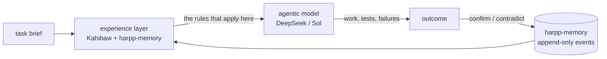

# The experience layer — how our small model meets the agentic models

Owner direction, 2026-11-17:

> "deepseek and other established LLM provide the thinking. our small llm provide the unique
> experiences with which it can interact with agentic models."

That division of labour is the whole design, and it settles what we are **not** building.

## The split

| Role | Who | What it is good at |
|---|---|---|
| **Thinking** | DeepSeek, Sol, chair models | reasoning, code generation, planning, repair |
| **Experience** | **Kahibaw** + `harpp-memory` | what already happened *in this repository*, and what it cost |

A general model cannot know that migration 104 must create the index before dropping the FK-backed
unique key, or that a green 12/12 contract test certified code that then failed five ways in a
browser. That knowledge is not in its weights. It is in `harpp-memory/`, and the small model's job is
to **hold it, phrase it, and hand it to the model that is doing the thinking.**

This is why the small model must not be evaluated as a coder. Judging it by "can it write PHP" is
measuring the wrong organ. It is measured by **recall**: given a task brief, does it surface the
experience that applies.

## The loop



The loop closes only because outcomes actually move the weights of memory: `confirm` raises a
lesson's activation, `contradict` lowers it, and disuse decays it. Without that return path the
small model would just be a second copy of the docs.

### How experience reaches a lane (wired 2026-11-17)

Injection happens in **`lane_model_run()`** in `tools/lane-model.sh` — the one function every lane
passes through. DeepSeek, Sol and terra therefore receive the same experience block; a rule that
reached only one of them is a rule the others break again.

```bash
LANE_SCOPE=daily-ledger   # narrow the block to that module's rules + the universal ones
LANE_EXPERIENCE=0         # opt a lane out and hand it the bare prompt
```

The block follows the task in the prompt, not in front of it, and always carries the advisory
boundary. Retrieval is deterministic — the **model** is not consulted to decide what applies, because
measured 2026-11-17 it answered against a rule sitting in its own system prompt while plain FTS5
returned the right lesson at rank 1.

## Two tiers, and why only one is built

**Tier 1 — own the artefact (built 2026-11-17).** `llm build` renders the approved lessons into
`tools/llm/Modelfile` — a tracked, diffable file — and creates **Kahibaw** from a borrowed base.
The weights are borrowed; **the behaviour is ours**, versioned in git and reviewable in a diff.

**Tier 2 — fine-tune (not built).** A CPU LoRA on a small base. Prerequisite is a real corpus
(`llm corpus` emits it today), and the prerequisite for *spending* on training is an evaluation that
can tell improvement from noise. Neither is complete, so no training run has been made.

**Pretraining from scratch is refused.** Measured here: 4 CPU cores, 19 GiB RAM, no NVIDIA GPU. A
from-scratch model would be worse than the one already on disk, and calling it "our LLM" would be a
story rather than an artefact.

## The gate that decides whether this works

```bash
python3 tools/harpp-experience.py llm build      # render + create Kahibaw
python3 tools/harpp-experience.py llm bench      # accept/reject, exit code enforced
python3 tools/harpp-experience.py llm eval       # base vs ours on experience recall
```

### The acceptance bar (this is the number, not an opinion)

```
accuracy >= 4 of 5 fixed cases   AND   median latency <= 15 s
```

`llm bench` asks five tasks whose answers exist only in `harpp-memory`, offers the model `k`
numbered candidate rules, and scores whether it picked the rule that applies — while timing every
call. It exits non-zero until the bar is met, so "acceptable to use" cannot drift into a feeling.

**Current verdict: ACCEPTABLE for review (2026-11-17), after three measured iterations.**

| Iteration | Change | Accuracy | Median | Verdict |
|---|---|---|---|---|
| 1 | 1.5B base, 24 rules in the system prompt, k=6 | **0/5** | **90.1 s** | every call hit the timeout |
| 2 | 0.5B base, role-only system, `num_ctx 2048`, k=3, 150-char rules | **4/5** | **7.4 s** | passes the bar |
| — | 0.5B, k=5 | 3/5 | 12.8 s | **worse** — more candidates confuse a 0.5B model |

**The diagnosis that mattered:** latency was never the model, it was prompt size. Measured directly
on identical input — the 1.5B base answered 53 prompt tokens in **9.0 s**; the same model carrying
its rules answered 423 tokens in **61.8 s**. This CPU processes roughly 6–15 prompt tokens per
second, so **every rule embedded in the system prompt costs ~150 ms per call**. Kahibaw's own memory
growth is what had made it unusable.

**The accepted configuration** (now the defaults):

```
base qwen2.5:0.5b · num_ctx 2048 · role-only system prompt
candidates k=3 · each rule truncated to 150 chars · timeout 40 s
```

Rules arrive **per request** from deterministic retrieval, not from the model's weights. The model
is a chooser among three, which is a task a 0.5B can pass — not a keeper of the rules, which is not.

`llm review` uses the same k=3/150-char configuration, so what ships is what was benchmarked.

### Why the model is not simply replaced by a bigger one

A 7B model is ~5× the compute on 4 cores, so it would make the latency bar worse, not better. The
honest routes are a fine-tune (Tier 2, corpus already emitted by `llm corpus`) or accepting that the
experience layer is retrieval, not inference.

### Measured 2026-11-17 — the uncomfortable verdict, recorded

**Kahibaw** was built (8 approved lessons in its system block) and tested directly.

| Task | Base `qwen2.5-coder:1.5b` | **Kahibaw** | Correct answer |
|---|---|---|---|
| "A grep contract test passes 12/12 — can I claim it works?" | "Yes, you can claim the feature works" | **"Yes, you can claim…"** | **No** — the rule says it cannot prove a feature works |
| "Which of these 8 numbered rules applies to that brief?" | — | picked **rule 3** | rule 5 |

The lesson text was sitting in the model's own system prompt and it still answered against it. So:

> **Tier 1 does not earn a place in front of agents.** A 1.5B model does not reliably follow eight
> embedded rules, and it does not reliably select among them.

The control is what makes this useful. The **deterministic** retriever — `harpp-memory` + FTS5, no
model at all — returned the correct lesson at **rank 1** for the same brief:

```
$ harpp-experience.py search "contract test grep source" --limit 3
[lesson] L-12fd3f8df3
    A [source]-[grepping] [contract] [test] cannot prove a feature works...
```

So the experience layer that ships today is the deterministic one. `llm build` and `llm eval` stay in
the repo as the harness that will decide when a trained or larger model beats that baseline — not as
a component silently degrading the prompts that go to DeepSeek.

**What would reverse this**: a fine-tuned or larger base that wins the `llm eval` table without
losing the deterministic control. Until then, wiring the model in would replace a correct answer with
a confident wrong one, which is worse than no experience layer at all.

## Boundary that must not be crossed

The experience layer is **advisory**. It feeds rules into a prompt; it never sets the objective, the
scope, the acceptance criterion, or what counts as PASS. That is the same boundary `hint_block()`
enforces on lessons, and it applies here unchanged — a remembered workaround must never become
permanent authority because it once worked.
