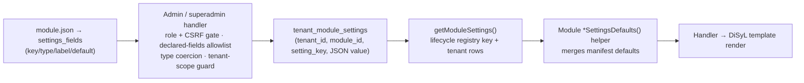

# Settings-change stability under Kernel OS + DiSyL — chair consult summary & verification

**Date:** 2026-10-11
**Sources:**
- Chair consultation, session `settings-stability` — full transcript: [`.ai/consult/settings-stability.md`](../../.ai/consult/settings-stability.md)
- Verification pass over the repository the same day (file:line evidence below). The chair is advice, not evidence — its claims were checked against the code before being accepted.

**One-line verdict:** the manifest-declared, kernel-persisted, per-tenant settings model is sound and deliberate (kernel philosophy + stable contracts); single client-requested settings changes are low-risk and additive — the accumulating risks are default changes, toggle combinations, and renames, and those need a formal evolution policy rather than a new subsystem.

---

## 1. The question

How stable, easy and manageable are per-client settings changes in a module — and is this something to do with the kernel philosophy and conventions?

## 2. Verdict — yes, it is the philosophy and conventions

- `docs/PHILOSOPHY.md:42-48` — settings are explicitly **module-owned** ("business logic and domain rules", "their own templates and views", "**their own settings and configuration**"), while the kernel owns persistence, isolation and resolution.
- `docs/kernel/kernel-stable-contracts.md:21` — "settings field definitions used by module settings UIs" is listed as a **stable contract** of the module manifest; changing its meaning is a breaking platform change.
- `docs/kernel/kernel-stable-contracts.md:71-80` — the settings read/write helpers are "effectively part of the platform surface while modules depend on them."

Chair verdict (advice): **GO — retain architecture, strengthen contracts.**
Architecture `KEEP` · Manifest as schema authority `STRENGTHEN` · Per-tenant override storage `KEEP` · Type/default compatibility tests `PRIORITIZE` · Setting evolution & migration `FORMALIZE` · New generic settings framework `DO NOT BUILD YET`.

---

## 3. What actually happens when a client requests a settings change (verified)

1. **Declaration** — `modules/<id>/module.json` → `settings_fields` with `key`/`type`/`label`/`default`/`description`. Example (daily-ledger, `module.json:351-419`): `production_output_enabled` default `"0"`, `consignee_enabled` default `true` with a behavior-preserving description ("existing consignee deliveries … remain visible when off").
2. **Write** — `src/http/admin-handlers.php:2733-2896` and `src/http/superadmin-handlers.php:721-830`: role check, kernel CSRF enforcement, **only declared `settings_fields` are writable**, type coercion (checkbox→bool, number→numeric, select→validated against options), tenant-scope guard (`admin-handlers.php:2852`), audit via `kernel.audit.record@1` (`:2880`, best-effort), admin view-cache invalidation (`:2894`). Superadmin must supply a `tenant_id` validated against active `kernel_tenants`.
3. **Store** — `saveTenantModuleSettings` upsert (`src/helpers/module-manager.php:1323+`) into `tenant_module_settings` (one kernel-owned table; JSON values).
4. **Read** — `getModuleSettings` (`src/helpers/module-registry.php:786-813`): global registry contributes only the lifecycle key `allow_kernel_admin` in tenant mode; everything else comes from tenant storage; `_`-prefixed keys never leak. Reads are preloaded per request (`module-manager.php:1192-1276`) and invalidated on save.
5. **Fail-closed isolation** — tenant mode + unresolved tenant ⇒ `saveModuleSettings` **refuses** the global-registry fallback instead of leaking tenant settings (`module-registry.php:826-839`).
6. **Manifest defaults merge** — implemented as a per-module helper convention (~12 modules: `aiSettingsDefaults`, `antispamDefaultSettings`, `bakeshopSettingsDefaults`, `cmsSettingsDefaults`, `contactFormSettingsDefaults`, `dcSettingsFields`, `ecSettingsDefaults`, `guiSettingsDefaults`, `moodleIntegrationSettingsDefaults`, `tkSettingsDefaults`, `smsSettingsFieldDefinitions`, `moto_inventory_settings`). Not a central kernel resolver.
7. **DiSyL** — the engine contains **zero** settings references (`kernel/DiSyL/**` scan). Templates render handler-resolved values; policy resolution never lives in the template layer.
8. **Contract test** — `tests/manifest_settings_defaults_test.php` enforces manifest defaults across 10 settings-bearing modules (cms, ecommerce, anti-spam, ai, daily-ledger, sms, ticketing, gui-settings, contact-form, guidance).

---

## 4. Verified strengths (why single client changes are easy/stable today)

- Additive change pattern: new toggle + backward-compatible default; defaults preserve existing observable behavior.
- Per-tenant override is a **native kernel layer**, not a custom build (unlike WordPress/Laravel/Django).
- Write gates: role, CSRF, declared-fields allowlist, tenant validation, audit, cache invalidation.
- Fail-closed tenant isolation (no cross-tenant leak, even on tenant-resolution failure).
- Settings declarations and helpers are documented stable contracts, with an existing contract test as the enforcement point.
- DiSyL stays a renderer; module handlers own interpretation (matches the microkernel principle).

## 5. Verified gaps / accumulating risks (ranked)

| # | Risk | Severity | Verified status |
|---|---|---|---|
| 1 | **Default changes silently alter tenants without overrides** — a tenant with no stored value inherits the new default after deploy | Critical | Confirmed: reads merge current manifest default when the key is absent |
| 2 | **Toggle combinatorics** — 10 booleans = 1,024 combinations; schema validity ≠ business validity | Critical | Structural; no cross-setting policy validator found |
| 3 | **Type drift / truthiness** — `false` vs `0` vs `"0"` vs `"false"`; `saveTenantModuleSettings()` itself performs **no** type validation — coercion exists only in the HTTP handlers | High | Confirmed: validation is handler-level only |
| 4 | **Renames** — no alias/deprecation/migration mechanism for setting keys; stored overrides can go invisible | High | Confirmed: no mechanism found |
| 5 | **Settings crossing into hidden business policy** — a toggle bypassing authorization/approval/accounting invariants, or other modules reading raw setting keys | Critical | Boundary principle stated; enforcement is convention |

Extra nuance found during verification: because the manifest-defaults merge is a **per-module convention**, a module can omit it — a real bug class already recorded (AI settings blank-string values masking manifest defaults).

## 6. Comparison with multi-purpose frameworks (chair analysis)

| Property | Ikabud | WordPress | Laravel | Django | Shopify themes |
|---|---|---|---|---|---|
| Schema declaration | **Manifest (required for UI write)** | Optional registration | Config arrays | settings.py | settings_schema.json |
| Defaults | Manifest merge | Registered/read fallback | Config/package defaults | Global/app defaults | Schema defaults |
| Per-tenant override | **Native kernel layer** | Custom / Multisite | Custom | Custom | Per theme/store |
| Settings migration | Custom policy needed | Plugin logic | Config/data logic | Code/data logic | Theme migration logic |
| Schema-based UI | Partly (manifest-driven) | Registration + UI work | Custom | Custom | Native editor |
| Contract testing | **Existing module test** | Developer-managed | Strong | Strong | Schema tooling |
| Main drift risk | Tenant override drift | Options sprawl | Env/published-config drift | Deployment drift | Theme data/schema drift |

Chair's framing: *"Its strongest property is not that settings are easy to add — WordPress, Laravel, and Django can all make adding a setting easy. Its advantage is the combination of module-owned declarations, kernel-controlled tenant persistence, manifest-derived editable UI, defaults that permit backward-compatible deployment, one override-resolution mechanism, and contract tests."*

## 7. Guardrails / next small steps (no new framework)

1. **Expand `manifest_settings_defaults_test.php`** — every editable key has declared type + valid default; no duplicate keys; `false`/`0`/`""`/`null`/absent distinguished; stored overrides round-trip without type change; invalid values are rejected with a documented policy.
2. **Canonical type normalization at read + write** — never rely on PHP truthiness for configurable business behavior.
3. **Additive-change + rename policy** — new settings must preserve existing behavior by default; renames require explicit alias/deprecation/migration with override preservation (conflict = stop and report, never silently pick).
4. **Effective-value diagnostics** — a read-only view answering "why is this tenant's behavior different?" (effective value, source: manifest default vs tenant override, declared type).
5. **Keep the boundary strict** — kernel stays generic (no per-module special cases); module owns policy validation; DiSyL renders resolved values only; cross-module settings consumption goes through an explicit capability, never by reading another module's raw keys.

**Governing release invariant (chair):** a setting can be added, changed, tested, deployed, diagnosed and eventually retired *without unexpectedly changing another tenant's business behavior*.

---

## 8. Artifacts

- Full consultation transcript (resumable via `--session settings-stability`): [`.ai/consult/settings-stability.md`](../../.ai/consult/settings-stability.md)
- Repo memory note with the verified file:line trail: `/memories/repo/settings-change-stability-2026-10-11.md`
